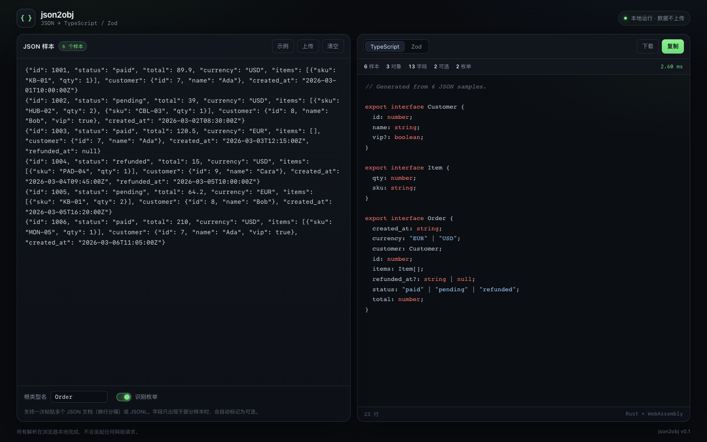

# json2obj

在浏览器本地把 JSON 转成 **TypeScript 接口** 和 **Zod schema**。Rust + WebAssembly，数据不上传。



## 为什么不是又一个 json2ts

大多数在线工具只接受一个样本，所以生成出来的字段全是必填、字符串全是 `string`、枚举完全识别不出来。真实的 JSON 往往是一批数据，而不是一条。

这个工具围绕三件事来做：

- **多样本合并推断**：粘贴多个 JSON 文档（换行分隔）或 JSONL，自动统计每个字段的出现率，缺失字段标 `?`，重复值识别成枚举。
- **本地优先**：解析全部在 WASM 里完成，打开 DevTools 看不到任何外部请求。生产数据的手机号、订单号、地址不需要上传。
- **快**：核心用 Rust 写，约 140 KB WASM，几百个样本通常 1 ms 出结果。

## 功能

- 多个 JSON 文档 / JSONL 一次粘贴，也可以拖入 `.json`、`.jsonl` 文件
- 自动推断 `optional`、`null`、`number`、`boolean`、嵌套对象、数组
- 在样本足够时识别字符串枚举（带自由文本字段名黑名单，避免把 `name` 猜成枚举）
- 生成 TypeScript 接口，或 Zod schema + `z.infer` 类型
- 根类型名可配置，嵌套类型自动命名（`users` → `User`）
- 复制、下载、错误定位（直接给出 JSON 解析的行列号）

## 快速开始

需要 Rust（含 `wasm32-unknown-unknown` target）和 `wasm-pack`。

```bash
# 一次性准备
rustup target add wasm32-unknown-unknown
brew install wasm-pack        # 或 cargo install wasm-pack

pnpm --dir web install      # 安装前端依赖
pnpm wasm                   # 编译 Rust → web/src/wasm
pnpm dev                    # http://localhost:5173
```

构建静态站点：

```bash
pnpm build                   # 输出到 web/dist
pnpm preview
```

跑 Rust 测试：

```bash
pnpm test                    # cargo test -p json2obj-core
```

## 项目结构

```
crates/core       推断 + 代码生成，纯 Rust，无 I/O
  src/infer.rs    类型格：合并样本、统计 missing/seen、枚举元数据
  src/render.rs   TypeScript / Zod 渲染、命名、可选与可空
crates/wasm       wasm-bindgen 薄封装，一次调用返回 JSON
web               Vue 3 + Vite 界面
  src/wasm/       由 `pnpm wasm` 生成（已提交，方便直接部署）
```

核心 crate 不依赖 UI，后面加 CLI 或 Tauri 壳只需要复用 `json2obj_core::generate`。

## 推断规则

| 情况 | 结果 |
| --- | --- |
| 字段只出现在部分样本 | `field?: T` |
| 同一字段出现 `null` 和 `T` | `T \| null` |
| `1` 和 `1.5` 混用 | `number` |
| 字符串枚举 | 至少 6 次观测、2–8 个不同值、平均每个值出现 2 次以上 |
| 空数组 | 元素类型先记为 `unknown`，有样本后再补 |
| 类型分支超过 4 种 | 退化为 `unknown` |
| 对象命名 | 字段名单数化 + PascalCase，重名自动加数字后缀 |

`name`、`email`、`id`、`sku`、`description` 等字段默认不识别成枚举，即使小样本里碰巧重复。

## 已知边界

- 目前只输出 TypeScript / Zod；Java、Go、Rust 等实体类生成在路线图里。
- 单个超大数组会完整读入内存；>100 MB 的文件建议先用 `jq` 切分。
- 枚举是启发式判断，生成后建议人工确认一次。
- 对象字段按字母序输出（serde_json 默认行为）。

## Roadmap

- [ ] 生成带默认值的对象工厂（运行时实例）
- [ ] Java record / Go struct / Rust serde 代码生成
- [ ] 多样本 schema diff（新增、删除、可空性变化）
- [ ] 把 schema 压缩进 URL hash 的分享链接
- [ ] CLI 与 Tauri 壳

## License

MIT
